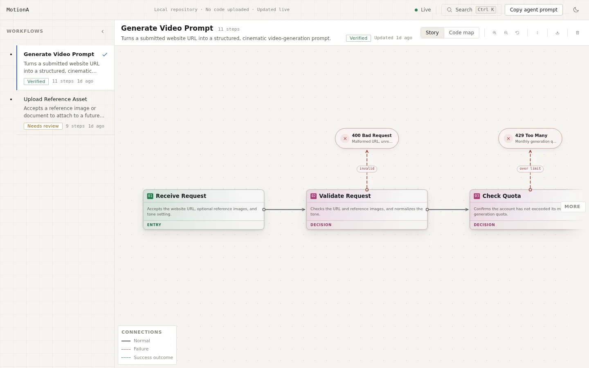

# HQFlow

HQFlow is a local-first web app that renders your coding agent's understanding of
your codebase as an interactive workflow canvas. You run it inside your own repository; your
existing agent (Cursor, Claude Code, Codex, or similar) reads `.codehq/SKILL.md`,
inspects your real source code, and writes structured workflow JSON into `.codehq/`.
HQFlow watches those files and renders them in your browser as you work. **It contains no LLM
of its own and never uploads your code anywhere** — everything runs
on `localhost`.

## See HQFlow in action

The image follows your light or dark system theme.

<picture>
  <source media="(prefers-color-scheme: dark)" srcset="./docs/assets/hqflow-canvas-dark.webp">
  <source media="(prefers-color-scheme: light)" srcset="./docs/assets/hqflow-canvas-light.webp">
  
</picture>

## Privacy & security

- Runs entirely on your machine (`localhost`)
- Never uploads repository source to a remote service
- Contains no built-in LLM — your existing coding agent authors the `.codehq` files
- Accounts and cloud sync are optional and off by default. See [Accounts and sync](#accounts-and-sync).

See [SECURITY.md](./SECURITY.md) to report vulnerabilities privately.

## The core loop

```
you run `hqflow open`
        |
        v
  browser opens at http://localhost:4310
        |
        v
  you ask your agent: "map the checkout workflow"
        |
        v
  agent reads the repo + .codehq/SKILL.md
        |
        v
  agent writes .codehq/workflows/checkout.json
        |
        v
  the board updates live, in your browser, no refresh
```

## Quickstart

```sh
npx hqflow init
npx hqflow open
```

Then paste this into your coding agent:

> Read `.codehq/SKILL.md`, then document the checkout workflow. It starts at the
> `POST /api/checkout` route. Trace it through order creation, payment, and confirmation
> email, and write the result to `.codehq/workflows/checkout.json`.

## Commands

### `hqflow init [--force]`

Scaffolds `.codehq/` in the current repository: `project.json`, `SKILL.md`, and an empty
`workflows/`. It also appends `.codehq/.runtime/` to your `.gitignore` (creating it if needed,
never duplicating the line).

`workflows/` starts empty. The canvas then shows its guided empty state, where you can copy a
prompt for your coding agent or recheck the files after the agent creates a workflow.

- `--force` — overwrite existing `.codehq` files. Without it, an existing file (for
  example a `SKILL.md` you have already edited) is left untouched and reported as unchanged.

### `hqflow open [--port <n>] [--no-open] [--root <path>]`

Starts the local server and opens the workflow canvas in your browser.

- `--port <n>` — port to listen on. Defaults to `4310`; if it is in use, the next free port is
  tried automatically and the fallback is reported.
- `--no-open` — start the server without opening a browser.
- `--root <path>` — repository root to serve. Defaults to walking up from the current
  directory looking for `.codehq/`, then `.git/`, then `package.json`.

Stop it with `Ctrl+C`.

### Canvas layouts

HQFlow automatically saves node positions after you move a card and edge bends after you adjust
a connection. The geometry is stored in `.codehq/.runtime/layout.json`, so it remains available
after you close the browser, stop HQFlow, or restart your computer. The file stays local to the
repository and is ignored by Git.

Pan, zoom, and expanded cards describe the current view, so they reset when you reopen HQFlow.
Use **Reset layout** to delete the saved node positions and edge bends and restore the generated
layout.

Also available: `--help`, `--version`, `--debug` (or `HQFLOW_DEBUG=1`) for full stack
traces on error.

## Accounts and sync

HQFlow works fully without an account. Make a free account only if you want your workflows on
other computers or on your phone.

```sh
hqflow login --create   # first time; confirm the email, then run `hqflow login`
hqflow sync             # in a repository: turns sync on and syncs now
hqflow open             # while sync is on, keeps syncing in the background
```

- `hqflow login [--create]`, `hqflow logout`, `hqflow whoami` — manage the login on this
  machine. The session is stored in `~/.hqflow/credentials.json`.
- `hqflow sync [--off] [--root <path>]` — sync this repository with your account. Run it in
  every repository you want under the same account. `--off` stops syncing this repository and
  does not delete its cloud copy.
- The hosted viewer at `/app` on the HQFlow site shows all your synced projects. It is
  read-only and works on a phone. You can also delete a project's cloud copy or your account there.

**What syncs:** `project.json`, `workflows/*.json`, saved canvas layouts, and the found/missing
status of source references. **What never syncs:** your source code, `SKILL.md`,
`diagnostics.json`, and absolute paths. Workflow files still contain repository-relative file
paths, symbol names, and descriptions of how your code works, so sync only repositories where
that is acceptable.

**Edits on two devices:** each sync copies only the side that changed since the last sync. If
the same workflow changed on both sides, the local copy wins and the cloud copy is saved to
`.codehq/.runtime/conflicts/<id>.cloud.json`. A file that is invalid locally is skipped and
never overwritten.

## The `.codehq` format

```
.codehq/
├── project.json          # project id/name and a few display settings
├── SKILL.md               # instructions for the agent authoring workflows
├── diagnostics.json        # appears only when validation errors need repair
├── workflows/
│   └── <id>.json           # one workflow per file
└── .runtime/                # local, gitignored runtime state
    └── layout.json           # automatically saved node positions and edge bends
```

A workflow is a directed graph of steps an agent has read against the real code — no
coordinates, colors, or styling, ever; HQFlow owns all of that. A short annotated
example:

```json
{
  "schemaVersion": "0.1",
  "id": "checkout",
  "name": "Checkout",
  "purpose": "Takes a cart to a confirmed, paid order.",
  "entryPoint": { "file": "app/api/checkout/route.ts", "symbol": "POST" },
  "steps": [
    {
      "id": "create-order",
      "name": "Create Order",
      "purpose": "Persists a pending order from the cart contents.",
      "category": "entry",
      "sources": [{ "file": "app/api/checkout/route.ts", "symbol": "POST", "line": 12, "endLine": 30 }],
      "outputs": [{ "name": "Order", "type": "Order" }]
    },
    {
      "id": "charge-payment",
      "name": "Charge Payment",
      "purpose": "Charges the customer's saved payment method.",
      "category": "external",
      "externalServices": [{ "name": "Stripe", "operation": "POST /charges" }],
      "edgeCases": [{ "name": "Card declined", "handling": "Order is marked failed; customer is notified." }]
    }
  ],
  "connections": [
    { "from": "create-order", "to": "charge-payment", "type": "success" }
  ]
}
```

Every object is validated strictly — an unrecognized key (especially a visual one like `x`,
`color`, or `style`) is a hard error, not a warning. Every `file` path must be
repository-relative. The full field-by-field reference lives in `.codehq/SKILL.md` after
you run `init`.

## Local development

```sh
pnpm install
pnpm dev            # web (Vite) + API server, in parallel
pnpm build          # dist/node, dist/web, and dist/export-viewer
pnpm test           # vitest
```

Other useful scripts: `pnpm typecheck`, `pnpm lint`, `pnpm test:e2e` (Playwright).

## Contributing

PRs are welcome — please target `dev`. See [CONTRIBUTING.md](./CONTRIBUTING.md). Direct
pushes to `main` and `dev` are blocked; changes land through pull requests.

## License

[MIT](./LICENSE)
