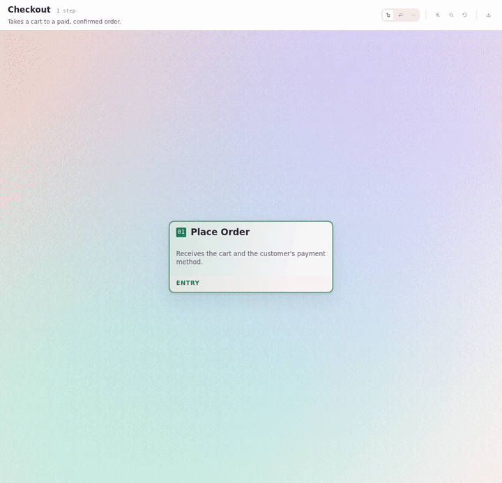

# HQFlow

HQFlow is a local-first web app that renders your coding agent's understanding of
your codebase as an interactive workflow canvas. You run it inside your own repository; your
existing agent (Cursor, Claude Code, Codex, or similar) reads `.codehq/SKILL.md`,
inspects your real source code, and writes structured workflow JSON into `.codehq/`.
HQFlow watches those files and renders them in your browser as you work. **It contains no LLM
of its own and never uploads your code anywhere** — everything runs
on `localhost`.

**[Try the live demo →](https://hqflow.vercel.app/)** · [npm](https://www.npmjs.com/package/hqflow)

## See HQFlow in action

An agent writes a checkout workflow, and HQFlow draws each step as the file changes. The
recording uses the Flow view and the Sorbet scene.



## What you get

- **Live drawing.** As your agent saves a workflow file, the canvas draws the new steps and
  connections in place. You do not refresh.
- **Three views.** Read a workflow as **Flow** (top to bottom, branches side by side), **Wrap**
  (rows that read left to right), or **Line** (one long row).
- **Evidence on every step.** Click a step to open its card: sources, inputs, outputs, edge
  cases, tests, and external services. **Open in editor** jumps to the referenced file.
- **Path tracing.** Hover a step to dim everything that is not on its paths.
- **Repository overview.** Ask your agent to map the whole repository. HQFlow shows every
  workflow and the handoffs between them, then fills each one in as its file arrives.
- **Search.** Press `Ctrl+K` / `⌘K` to jump to any workflow or step.
- **Scenes.** Light and dark themes, plus animated backgrounds (Abyss Mesh, Seafoam, Sorbet).
- **Card sizes.** Pick **Compact**, **Standard**, or **Wide** step cards in the Appearance panel.
- **Export.** Download a PNG, or a self-contained interactive HTML file that works offline.
  You can hide file paths before you share it.
- **Validation.** Files that break the contract are reported in the app and in
  `.codehq/diagnostics.json`, so your agent can fix them. Run `hqflow validate` in CI.

## Quickstart

```sh
npx hqflow init
npx hqflow open
```

Then paste this into your coding agent:

> Read `.codehq/SKILL.md`, then document the checkout workflow. It starts at the
> `POST /api/checkout` route. Trace it through order creation, payment, and confirmation
> email, and write the result to `.codehq/workflows/checkout.json`.

## The core loop

```
you run `hqflow open`
        |
        v
  browser opens at http://localhost:4310
        |
        v
  you ask your agent: "map the checkout workflow"
        |
        v
  agent reads the repo + .codehq/SKILL.md
        |
        v
  agent writes .codehq/workflows/checkout.json
        |
        v
  the board updates live, in your browser, no refresh
```

## Privacy & security

- Runs entirely on your machine (`localhost`)
- Never uploads repository source to a remote service
- Contains no built-in LLM — your existing coding agent authors the `.codehq` files

See [SECURITY.md](./SECURITY.md) to report vulnerabilities privately.

## Commands

### ChatGPT plugin

HQFlow also provides a local ChatGPT plugin using OpenAI MCP Extensions, with a
sidebar workflow library, the existing interactive canvas, workflow mentions, and
validated workflow saves. See [plugin setup](./plugins/hqflow/README.md) for building
and installing it. The plugin requires Node.js 22+; the existing CLI requires Node.js 20+.

`hqflow mcp [--root <path>]` starts its MCP server over stdio. Build the plugin assets
first with `pnpm build:plugin` when working from this checkout.

### `hqflow init [--force]`

Scaffolds `.codehq/` in the current repository: `project.json`, `SKILL.md`, and an empty
`workflows/`. It also appends `.codehq/.runtime/` to your `.gitignore` (creating it if needed,
never duplicating the line).

`workflows/` starts empty. The canvas then shows its guided empty state, where you can copy a
prompt for your coding agent or recheck the files after the agent creates a workflow.

- `--force` — overwrite existing `.codehq` files. Without it, an existing file (for
  example a `SKILL.md` you have already edited) is left untouched and reported as unchanged.

### `hqflow open [--port <n>] [--no-open] [--root <path>]`

Starts the local server and opens the workflow canvas in your browser.

- `--port <n>` — port to listen on. Defaults to `4310`; if it is in use, the next free port is
  tried automatically and the fallback is reported.
- `--no-open` — start the server without opening a browser.
- `--root <path>` — repository root to serve. Defaults to walking up from the current
  directory looking for `.codehq/`, then `.git/`, then `package.json`.

Stop it with `Ctrl+C`.

### `hqflow validate [--json] [--root <path>]`

Validates `.codehq/` and prints every issue. It exits with code `1` when a file is invalid, so
you can run it in CI or ask your agent to run it before handoff.

- `--json` — print only the diagnostics report as JSON.
- `--root <path>` — repository root to check. Defaults to the same detection as `open`.

### Canvas layouts

HQFlow automatically saves node positions after you move a card and edge bends after you adjust
a connection. Each view (Flow, Wrap, Line) keeps its own positions and bends. The geometry is stored in `.codehq/.runtime/layout.json`, so it remains available
after you close the browser, stop HQFlow, or restart your computer. The file stays local to the
repository and is ignored by Git.

Pan and zoom reset when you reopen HQFlow. **Reset layout** deletes the saved node positions and
edge bends of the current view and restores its generated layout.

Also available: `--help`, `--version`, `--debug` (or `HQFLOW_DEBUG=1`) for full stack
traces on error.

## The `.codehq` format

```
.codehq/
├── project.json          # project id/name and a few display settings
├── SKILL.md               # instructions for the agent authoring workflows
├── diagnostics.json        # appears only when validation errors need repair
├── workflows/
│   └── <id>.json           # one workflow per file
└── .runtime/                # local, gitignored runtime state
    └── layout.json           # automatically saved node positions and edge bends
```

A workflow is a directed graph of steps an agent has read against the real code — no
coordinates, colors, or styling, ever; HQFlow owns all of that. A short annotated
example:

```json
{
  "schemaVersion": "0.1",
  "id": "checkout",
  "name": "Checkout",
  "purpose": "Takes a cart to a confirmed, paid order.",
  "entryPoint": { "file": "app/api/checkout/route.ts", "symbol": "POST" },
  "steps": [
    {
      "id": "create-order",
      "name": "Create Order",
      "purpose": "Persists a pending order from the cart contents.",
      "category": "entry",
      "sources": [{ "file": "app/api/checkout/route.ts", "symbol": "POST", "line": 12, "endLine": 30 }],
      "outputs": [{ "name": "Order", "type": "Order" }]
    },
    {
      "id": "charge-payment",
      "name": "Charge Payment",
      "purpose": "Charges the customer's saved payment method.",
      "category": "external",
      "externalServices": [{ "name": "Stripe", "operation": "POST /charges" }],
      "edgeCases": [{ "name": "Card declined", "handling": "Order is marked failed; customer is notified." }]
    }
  ],
  "connections": [
    { "from": "create-order", "to": "charge-payment", "type": "success" }
  ]
}
```

Every object is validated strictly — an unrecognized key (especially a visual one like `x`,
`color`, or `style`) is a hard error, not a warning. Every `file` path must be
repository-relative. The full field-by-field reference lives in `.codehq/SKILL.md` after
you run `init`.

## Local development

```sh
pnpm install
pnpm dev            # web (Vite) + API server, in parallel
pnpm build          # dist/node, dist/web, and dist/export-viewer
pnpm test           # vitest
```

Other useful scripts: `pnpm typecheck`, `pnpm lint`, `pnpm test:e2e` (Playwright).

## Contributing

PRs are welcome — please target `dev`. See [CONTRIBUTING.md](./CONTRIBUTING.md). Direct
pushes to `main` and `dev` are blocked; changes land through pull requests.

## License

[MIT](./LICENSE)
